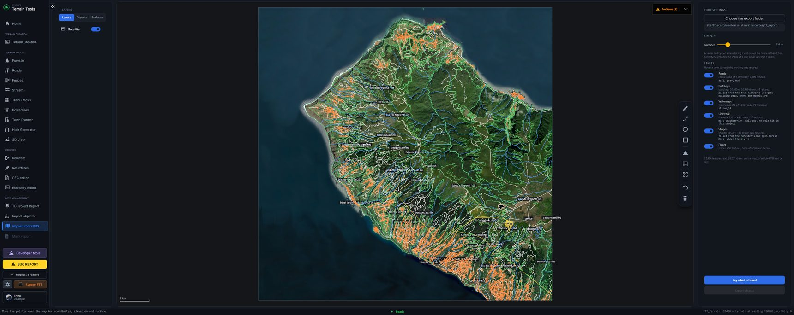

[← Guide](../GUIDE.md)

# Import from QGIS

Turns a QGIS export — roads, rivers, walls, power lines, woods and building footprints out of
OpenStreetMap — into what FTT's tools lay.

## The export

FTT reads the folder the QGIS terrain addon writes: `roads`, `waterways`, `linework`, `shapes`,
`buildings` and `places`, with the `gtt_export.txt` beside them. It is found on its own when it sits
where the addon puts it, beside your terrain's `source` folder; otherwise **Choose the export
folder**, and FTT remembers it for that terrain.

The export states the mapframe it was written for, and FTT checks it against yours. An export for
another terrain is refused rather than laid 200 km away.

## The page

Every layer is listed with what it holds and what can be laid from it, and drawn on the map in its
own colour. Tick what you want and **Lay what is ticked** to lay a whole map at once with default
settings.

## In every tool

Each tool has its own **Use QGIS … Data** button at the top of its settings. It adds that tool's
layer to what is drawn, as ordinary lines or areas — move, reshape or delete them like your own,
**Ctrl+Z** takes the whole import back — and then **Lay** uses that tool's full settings.

| Tool | Button | What it adds |
|---|---|---|
| Roads | Use QGIS Road Data | Every road, each in the type set for its surface (below). |
| Streams | Use QGIS River Data | Streams, rivers and canals. |
| Fences | Use QGIS Wall Data | Walls, fences, retaining walls and guard rails. |
| Powerlines | Use QGIS Power Data | Power lines. |
| Forester | Use QGIS Forest Data | Woods, as areas to fill. |
| Town Planner | Use QGIS Building Data | A building on every footprint, the one whose size fits best, turned to lie along it. |

## Roads, by class

The export gives every road a class. FTT sorts them into three surfaces, and a small table under
**Use QGIS Road Data** sets the road type each is laid in:

| Surface | Classes |
|---|---|
| **Asphalt** | residential, living street, unclassified, tertiary, secondary, primary, trunk, motorway |
| **Gravel** | service |
| **Dirt** | track, softtrack, trackunclassified, dirtroad |

An asphalt class tagged with an unpaved surface in OpenStreetMap — dirt, sand, gravel — goes with
that surface instead. **Not laid:** footpaths and steps (DayZ's path models have nothing to join
them by) and `unfiltered`, which is the export saying it could not classify the road.

Every street keeps its name, so each is its own entry in **Saved roads** — see [Roads](roads.md).
