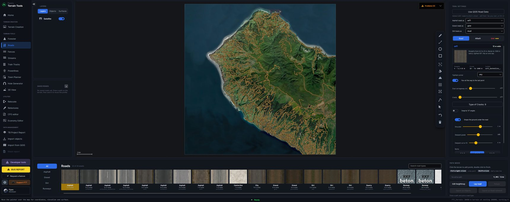

[← Guide](../GUIDE.md)

# Roads

Lays road pieces along a line you draw, so that each piece meets the next — with junctions, bridges,
sidewalks, lamps, signs and cracks, and the ground shaped under it.

## Drawing and laying

Click the map to add points and double-click to finish. **Ctrl+right-click** takes the last point
back, **Shift+click** starts a second line, and the ring, rectangle and line tools draw those shapes
in one drag.

Pick the **road type** from the pictures along the bottom bar: FTT reads every road family in your
template libraries and shows each one's texture.

Every line drawn is laid in one press, as one network: lines that continue each other are joined,
and where roads meet, the side road stops exactly at the kerb of the road carrying on — or on
DayZ's junction piece, where there is one for that pair of types.

| Button | What it does |
|---|---|
| **Edit heightmap** | The ground asked for under the roads — see [Edit heightmap](heightmap.md). |
| **Lay road** | Lays everything drawn. |
| **Retype** | Lays a chosen road again in the type picked (below). |
| **Export as Objects** | Writes the object list for TerrainBuilder. |
| **Export as Road network** | Checks TerrainBuilder is open and the work drive mounted. Building the road network inside TerrainBuilder is coming. |

## Roads from QGIS

**Use QGIS Road Data** brings in every road from the export. The table under it sets the type each
surface is laid in — **Asphalt roads as**, **Gravel roads as**, **Dirt tracks as** — and the line
under the button counts them: *"4,061 roads: 2,441 asphalt as asf1, 683 gravel as grav, 937 dirt as
mud."* Then one press of **Lay road**. See [Import from QGIS](qgis.md) for which classes go where.

## Saved roads

Every road you lay is kept under **Saved roads** in the layers column — an imported road as one
entry per street, by its name.

- **Click** a road to light it in red on the map.
- **Retype:** pick a road type in the bottom bar and press **Retype**. That road changes; every other
  road keeps its own type, and side roads still meet it at its new kerb.
- **Right-click** a road to **Rename**, **Open** or **Remove** it. A name you give is kept when the
  road is laid again.
- **Open** puts the line and its settings back without laying anything.

Saved roads are kept with the terrain, including a terrain opened by its folder.

## The panel

### Road

| Setting | What it does |
|---|---|
| **Tightest corner** | The sharpest corner the road may make. |
| **Run all the way to the last point** | Carries the road to the end of your line rather than stopping at the last piece that fits. |
| **Dual carriageway (m)** | Lays two roads either side of the line you drew, this far apart, with an optional barrier between. |
| **Cracks** / **Type of Cracks** | Drops crack decals on this share of the pieces. **Type of Cracks** shows how many kinds are in use; hover a crack for a bigger picture. |
| **Snap to 15° angles** | Keeps drawn corners tidy. |
| **Shape the ground under the road** | Holds the road's width plus a **Shoulder** level, keeps it under the **Steepest grade**, never cuts or fills more than **Deepest cut or fill**, and banks back to the ground (**Banks**: 1 in 1, 1 in 2, 1 in 3). |

### Attach

The box at the top shows the road the attachments apply to — pick one in Saved roads or click it
with the select tool.

| Tab | What it does |
|---|---|
| **Signs** | Corner warnings before sharp bends, speed signs at a spacing, which side, and **Place one by hand**. |
| **Sidewalks** | A sidewalk beside the road — family, side and gap from the road. |
| **Lamps** | One every so many metres, left, right or alternating, and how far back from the kerb. |
| **End caps** | An end piece at the start, the finish or both. |
| **Junctions** | Turn a laid T into a crossroads or back. |
| **Bridges** | **Bridge rivers and ravines**, and how deep a ravine has to be. Put in as a road is laid, with the ground shaping on. |

### Grid — *coming soon*

Fill a rectangle with streets. Greyed because DayZ's junction pieces only cover some pairs of road
types.
