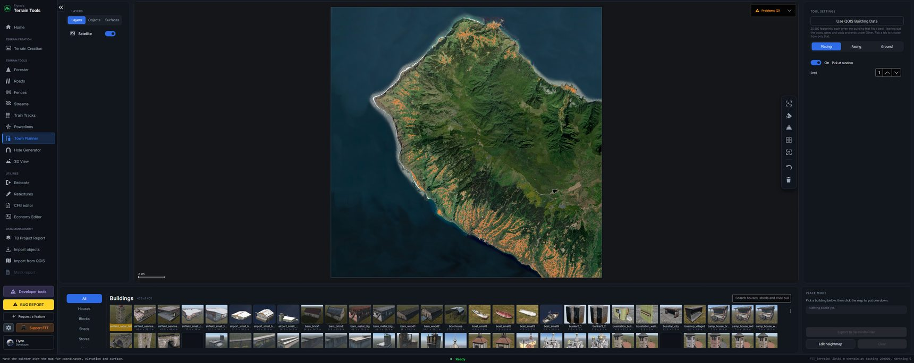
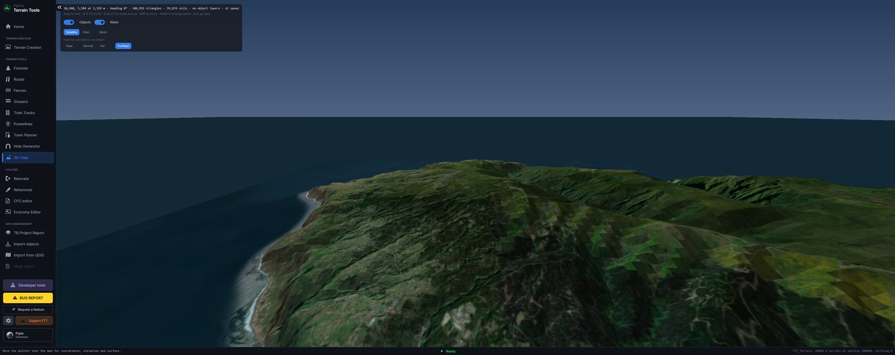

[← Guide](../GUIDE.md)

# Town Planner and 3D View

## Town Planner

Clicks buildings onto the map, turned to line up with the nearest road.

**Placing.** Pick a building from the palette and click the map. **Ctrl+right-click**, or the undo
button in the map tools, takes the last one back. **Pick at random** takes a different building from the palette for each click, from the
**seed** — so a street is not the same house twenty times. Re-roll the seed for a different set.

**Facing.**

| | |
|---|---|
| **Along road** | The long side runs along the road, which is how houses line a street. |
| **Across** | The long side runs across the road, so the building presents its narrow end to it. |
| **Free** | Ignore the road and use the **angle** below. |
| **Flip 180°** | Turns it round. |

Front and back cannot be told apart from a model's shape — DayZ's buildings do not say which way
they face in anything FTT can read — so the flip is offered rather than guessed. About one building
in five is square enough to have no long side at all, and the panel says so rather than pretending.

**What is offered.** A model is a building if it has doors, or if it is named as a building in
`mapgrouppos.xml`. Parts — walls, roofs, balconies — have neither and stay out of the list. The
palette has tabs for **Houses**, **Blocks**, **Sheds**, **Stores**, **Civic**, **Offices**,
**Industrial**, **Military**, **Churches** and **Other** (wrecks, ruins, bunkers, fuel stations,
monuments).

**From QGIS.** **Use QGIS Building Data** puts a building on every footprint in the export: the one
whose size fits best, turned to lie along it. With **All** showing it uses houses, blocks, sheds,
stores, civic and offices; pick a tab to use only that.

**Level the ground under buildings.** A flat pad under each building, with a **Margin** round it,
**Level at** the average, lowest or highest of the ground under it. Written with
[Edit heightmap](heightmap.md).

**Edit heightmap**, **Clear** and **Export to TerrainBuilder** sit at the bottom.

---

## 3D View

Flies over your own heightfield, with the satellite map draped over it, water, and every placed
object at its real size — trees as a trunk and a crown, buildings with a pitched roof, bushes and
rocks as domes, everything else as a box. It is a viewer: nothing here changes your terrain.

**Flying.** Mouse to look, **W A S D** to fly, **Q** and **E** for down and up, **Shift** to hurry.
The camera never drops below the ground.

**Draw distance** — **Near**, **Normal**, **Far** or **Furthest** — sets how far out objects are
drawn. Far is the default; Near and Normal are there for a slower machine.

**Three looks:**

| | |
|---|---|
| **Satellite** | The satellite map over the shaded ground — what the terrain looks like. |
| **Plain** | Grey ground with the shading alone, which is how you read *shape* rather than ground cover. |
| **Mesh** | The triangles themselves. |

The satellite drape is one image over the whole terrain, so it goes soft near the ground — that is
resolution, not a fault. Real models are not drawn: DayZ ships them compressed in a way nothing
outside its own tools can read, so a shape at the model's exact size is what the data supports.
